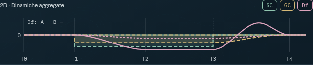
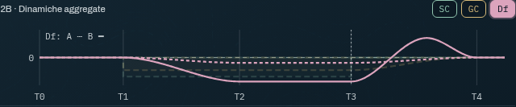
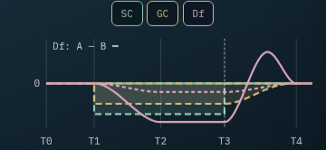
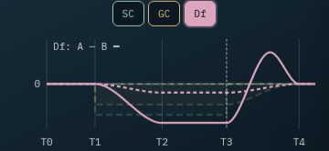
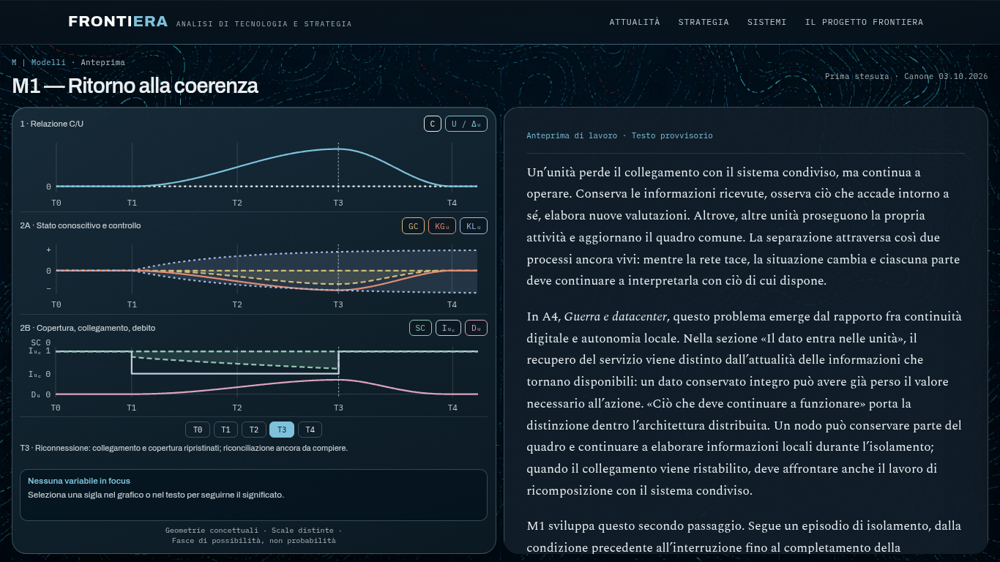
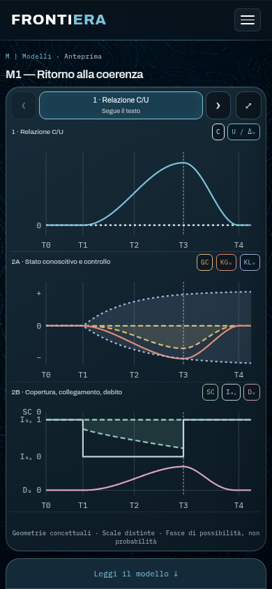
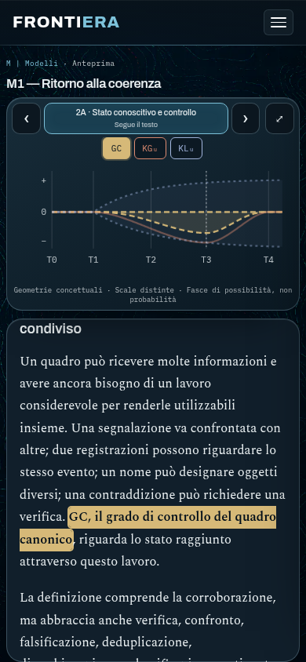
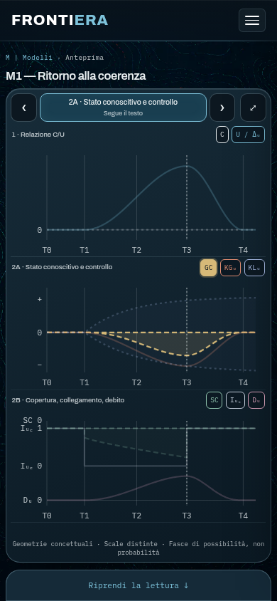

# Model Reader — anteprima M1

Il lettore è disponibile in sviluppo a `/anteprime/modelli/m1/` dopo `npm run serve`
(porta predefinita Eleventy: 8080). Con la build statica e il server dei test:
`npm run build`, poi `node tests/browser/static-server.cjs` e
`http://127.0.0.1:4173/anteprime/modelli/m1/`.

È un prototipo: `noindex: true`, `eleventyExcludeFromCollections: true`, nessun
collegamento aggiunto a navigazione, home, archivi o feed. Non sono state modificate
le sezioni pubbliche. La build genera l'anteprima per consentire deploy di prova;
`noindex` non costituisce una protezione di accesso. La pubblicazione editoriale di
M1 resta un'operazione successiva.

## Revisione Panel 2B e Df — 29 ottobre 2026

Branch derivato da `main` al commit canonico `be980815f60b374736cefdc3bc53147c68aefe36`.
Il testo di partenza ha SHA-256
`a6adda8e9358dbb6b7fb697f3e13231e009d6af130d70ff665aa498efa48eb09`.

- Zero operativo al centro dell’area utile, identico come coordinata per SC,
  GC e Df, senza equivalenze fra unità o significati. Rimossa la baseline
  separata del vecchio debito. SC/GC conservano le escursioni e le dinamiche
  precedenti, con sola traslazione verticale: SC chiude in T3, GC in T4.
- `DF` è l’unico identificativo di variabile; simbolo pubblico `Df`, nome
  «Debito funzionale». Il renderer produce due path `data-series="DF"`,
  distinguibili tramite `data-scenario="A"`/`"B"`. Un’unica voce di legenda,
  una cella e un richiamo testuale selezionano entrambe le traiettorie.
- A è tratteggiata: lieve riduzione, plateau e ritorno graduale. B è continua:
  riduzione pronunciata intorno a T2, plateau fino a T3, risalita con incrocio
  di A e possibile picco positivo, riassestamento in T4. Nessuna fascia Df.
  Il picco è uno scenario contingente, non una previsione necessaria.
- Le ordinate rappresentano `d_f(t) = D_f(t) − D_rif`; il riferimento
  fisiologico può essere positivo in assoluto. Un tratto sotto lo zero non
  indica debito assoluto negativo. Nessun legame deterministico con SC o GC;
  nessuna ampiezza calibrata o misura diretta della qualità conoscitiva.
- Conservati colori del lettore, focus esclusivo con override manuale, neutralità
  senza attenuazione, sincronizzazione contestuale mobile e renderer generico
  `model-reader.js`, che già gestisce tutti gli elementi della stessa serie.
- Prosa preservata: solo due identificativi tecnici e quattro correzioni
  circoscritte nel capitolo Df (inviluppo → scenari A/B, con chiarimento
  sull’incrocio). Nessuna modifica ai paragrafi fisiologia, sottoalimentazione,
  acquisizione/trattamento, recupero e distinzione dal controllo.
- Metadati e cornice dell’anteprima riportano la revisione del 29 ottobre,
  mantenendo `noindex` e l’esclusione dagli indici del sito.

### Discrepanza preesistente da sottoporre alla revisione editoriale

Il testo canonico di KGᵤ (Panel 2A) descrive un inviluppo che si apre in T3,
con bordo superiore che recupera immediatamente e bordo inferiore progressivo.
L’implementazione storica rappresenta invece una sola curva di recupero.
La discrepanza è già presente in `main`: questa revisione conserva sia la prosa
sia la geometria di Panel 2A, come richiesto dal mandato. Un eventuale
allineamento di KGᵤ richiede un intervento successivo esplicito.

### Verifica della revisione Df

- `npm run verify:model-m1`: **PASS**, inclusi 5.005 confronti geometrici storici.
- `npm run build`: **PASS**, build completa e tutti i verificatori di output.
- `PLAYWRIGHT_CHROMIUM_EXECUTABLE_PATH=/usr/bin/chromium npm run test:browser`:
  **149/151 PASS**, inclusi **44/44** test del lettore M1.
- Quattro verifiche Panel 2B ripetute dopo aver stabilizzato l’attesa del layout
  per gli screenshot: **4/4 PASS**.
- `git diff --check`: **PASS**.

La ripetizione mirata su `main` e sul branch dà in entrambi i casi
**1 PASS (STR2), 1 FAIL (End/Home)**.

I due fallimenti della suite globale riguardano componenti esterni al mandato:

1. `schema-str2.spec.js:167`, caso 1440 px: timeout nell’attesa di
   `data-str2-settled="true"` durante il momento 4. Il medesimo caso passa sul
   checkout separato di `main` e alla ripetizione sul branch, senza modifiche
   a STR2: timeout intermittente nella suite completa.
2. `technical-recon.spec.js:72`: dopo Control+Home, `scrollY` resta 18512 invece
   di 0. Il fallimento si riproduce identico sul `main` canonico
   `be980815f60b374736cefdc3bc53147c68aefe36`, coerentemente con la nota storica
   del 13–14 ottobre. La ripetizione sul branch conferma lo stesso errore.

Le build delle due pagine coinvolte (`/analisi/lyman-contesa-posizioni-sostegno/`
e `/fasi/manovra-fallita/`) coincidono **byte per byte** con quelle del checkout
separato di `main`. Coincidono anche tutti i JS e CSS esterni al lettore M1.
Il confronto usa Eleventy con i prerequisiti font e territori, senza modifiche
al testo o ai file versionati di `main`. Non sono stati alterati infobox, STR2,
i relativi test o timeout per aggirare questi esiti.

Screenshot riproducibili dei test in `reports/modelli/panel2b-*.png`:
320×568, 390×844, 1366×768 e 1440×900, ciascuno senza focus e con focus Df,
oltre al dettaglio del solo pannello. I test verificano entrambe le traiettorie,
focus dopo ridisegno SVG, zero mediano e contenimento nell’area utile.
I test di fallback e assenza di JavaScript verificano la fine del testo
canonico, anziché un titolo eliminato dalla revisione editoriale.

## Anteprime Panel 2B — revisione Df

Desktop, tutte le variabili e focus Df:

Mobile, tutte le variabili e focus Df:

## Anteprime storiche del lettore

## Fonti e integrità

`fonti-m1/` conserva i quattro allegati originali, esclusi dall'output insieme
all'intera cartella `docs/`. Per la revisione corrente la fonte editoriale canonica è
`src/_includes/modelli/m1.md`, commit `be980815f60b374736cefdc3bc53147c68aefe36`
(«Revisione testo terminata», 29 ottobre 2026). L’HTML originario rimane
un riferimento storico per le sole geometrie invariate di Panel 1 e 2A. Le funzioni `arc`, `local`,
`values`, `makePoints` sono estratte dalla sola visualizzazione M1. Non vengono
caricati iframe, wrapper Ruby, messaggistica host, Floating UI o altri script
esterni dell'allegato.

`src/js/model-m1.js` è l'unica fonte geometrica, usata da Eleventy per gli SVG
statici e dal browser per adattare il rendering. I valori originali sono mappati
affinalmente nell'area di ciascun pannello; font, assi e comandi mantengono dimensioni
leggibili in pixel CSS. Il focus modifica solo opacità/colore, mai i tracciati.
Panel 1 e 2A conservano le geometrie storiche. Panel 2B usa uno zero mediano
visivamente condiviso, con standard e scale distinti. SC/GC mantengono salti
e inviluppi; Df ha due traiettorie qualitative, con assestamento intorno a T2,
che non rappresenta un nuovo evento operativo.
I colori sono derivati dalle famiglie petrolio, azzurro, ruggine e verdi del sito.

`src/_includes/modelli/m1.md` conserva la revisione editoriale definitiva del 29 ottobre. L'H1 è
reso nel layout; la formula e i suoi due simboli inline hanno markup HTML
accessibile anziché delimitatori LaTeX non renderizzati. Le sole correzioni
editoriali correnti distinguono gli scenari Df dagli estremi di un inviluppo.
Le occorrenze evidenziabili usano `data-term`, esplicito, senza sostituzioni globali.

## Contratto per altri modelli

- Un modulo `src/js/model-<id>.js` esporta `panels`, `defs`, `phases`,
  `render(panel, width, height, event)`. Nel browser si registra in
  `window.FrontieraModels[id]`; nel build usa CommonJS.
- `defs` contiene `id`, `panel`, `symbol`, `name`, `description`. Il grafico usa
  `data-series="id"`; le palette sono variabili CSS locali. I simboli possono
  differire dagli identificativi interni (es. `KG` → KGᵤ).
- Il contenuto Markdown usa `:::segment <indice-pannello> [id-variabile]`.
  Ogni marcatore inizia un nuovo segmento; l'ultimo termina a fine documento.
  Il renderer `src/_lib/modelli/content.js` valida i riferimenti e genera i soli
  margini analitici dei segmenti di variabile. È Markdown di repository fidato.
- Una pagina `.11ty.js` fornisce il modello al layout `layouts/modello.njk` e
  passa la prosa al renderer. Il layout eredita la shell globale di Frontiera.
- `model-reader.js` non conosce i nomi delle variabili né le geometrie M1.
  I fogli/script sono caricati da `base.njk` solo in presenza del lettore.

## Stati e comportamento

Lo stato spaziale `space` (panoramica/lettura/espanso) e il riferimento temporale
`time` sono indipendenti dalla modalità di interazione `mode`. Un solo resolver determina
insieme pannello e focus:

| Modalità | Pannello | Focus |
| --- | --- | --- |
| `auto` | Segue il testo; passaggio continuo e reversibile su mobile | Variabile contestuale o neutro |
| `focus` | Quello della variabile scelta, anche scorrendo altri capitoli | Manuale persistente; anche neutro su desktop |
| `free` | Quello scelto con frecce o swipe | Nessuno |

Su mobile il primo tap su una variabile automatica la fissa manualmente. Il secondo tap
sulla stessa selezione manuale ripristina AUTO. Frecce e swipe cancellano il focus
precedente: prevale l'ultima scelta. “Allinea il focus al testo” è disponibile in
entrambe le modalità manuali e richiama la stessa operazione del selettore del
pannello: azzera gli override e ricalcola il contesto, senza spostare la prosa,
cambiare l'espansione o il tempo selezionato.

Su desktop AUTO è la modalità predefinita: il focus segue il segmento a 32 px
dall’inizio dell’area di lettura; i segmenti neutri mostrano tutte le curve senza
attenuazione. Su mobile il riferimento resta sotto il grafico compatto, secondo
il comportamento già esistente. Entrambi i layout usano lo stesso resolver e la
stessa evidenziazione di legenda, margini, tracciati e richiami testuali.

Una selezione esplicita blocca il focus in modalità manuale, anche durante lo
scroll. Su desktop il secondo clic sulla stessa variabile disattiva il focus e
mantiene lo stato manuale neutro; «Allinea il focus al testo», ora disponibile
anche su desktop, ripristina immediatamente AUTO. Su mobile il secondo tap
continua a ripristinare AUTO. La navigazione libera fra pannelli resta distinta.

Le variazioni di altezza dei segmenti aggiornano le coordinate memorizzate tramite
ResizeObserver. Il cambio di layout conserva l’ultimo contesto di lettura stabile.
Il focus automatico non scrive la posizione dello scroller: scorrimento, velocità
e inerzia rimangono nativi; nessuno snapping o inseguimento del testo.

Su mobile un solo contenitore scorre nativamente, anche dal fondo non interattivo
del grafico. Non ci sono listener wheel/touch che impongono lo scroll, snap o
catture verticali. Durante l'ingresso l'altezza del grafico deriva linearmente
dall'offset; la prosa emerge dietro una maschera e un bordo fisso. Al confine dei
capitoli il contenuto del grafico trasla lungo una zona proporzionale all'altezza
di lettura, in entrambe le direzioni. Fermare il gesto ferma il passaggio. Le
animazioni temporizzate sono riservate a espansione/contrazione manuale e selezione
manuale dei pannelli; `prefers-reduced-motion` le elimina e rende discreto il
cambio contestuale, preservando le funzioni.

L'espansione manuale mostra sempre i tre pannelli, senza cambiare `scrollTop`
o modalità interattiva. La ripresa conserva l'offset esatto, anche durante un
inserimento parziale, e ripristina il pannello del resolver. Dalla panoramica
iniziale “Leggi il modello” completa l'ingresso nella lettura. La linguetta è alta
2,75 rem più la safe area inferiore: la superficie raggiunge il bordo del viewport,
mentre il contenuto del comando resta sopra l'area riservata al sistema. Resize e orientamento conservano
il contesto; i cambi fra layout ricollocano il segmento in lettura. Il layout
senza JavaScript è un flusso ordinario con tre SVG e tutta la prosa.

## Misura del layout

La scelta non usa un breakpoint di dispositivo. Un duplicato inerte, fuori
schermo e nascosto alle tecnologie assistive, misura la stessa colonna grafica
nelle sue dimensioni desktop minime, senza duplicare ID o stato interattivo.

- **X**: altezza intrinseca effettiva della colonna completa, inclusi pannelli,
  controlli temporali, descrizione e note. Alla dimensione standard del testo:
  circa **583 px** su desktop (565 px con le regole compatte sotto 600 px).
- **Y**: header globale misurato + testata del modello + margini: circa
  **149 px a 1024×768**, **158 px a 1366×768**.
- Desktop quando l'altezza disponibile supera X di almeno 2 px e la larghezza
  consente due colonne (56 rem complessivi, almeno 26 rem per colonna).
- I tre grafici hanno minimi rispettivamente 5, 6 e 6,5 rem, verificati sui
  viewport di prova; lo spazio supplementare viene distribuito fra i pannelli.
  La descrizione ha altezza stabile per evitare oscillazioni con la selezione.
- Misura tramite ResizeObserver, font caricati, resize e `visualViewport`.
  Lo scroll usa coordinate dei segmenti memorizzate e aggiornamenti con rAF.
- Il workspace deriva da altezze intrinseche (header, testata, margini) e altezza
  di `visualViewport`, mai dalla coordinata esterna del workspace.
- Solo dopo un'inizializzazione riuscita, `html`, `body` e `main` sono contenuti
  nel viewport; il lettore è fisso sotto l'header. Nessuna intercettazione touch
  o wheel globale. Il footer è escluso dal solo layout Modelli. Senza JS, con
  modulo assente o con un errore nel rendering iniziale, il testo resta nel
  normale flusso del documento; nel caso di errore sono ripristinati gli SVG statici.

1024×768 e 1366×768 usano desktop; 1000×660 e 768×1024 usano mobile.
Con testo al 150%, 1024×768 passa correttamente a mobile. Gli SVG sono più densi
nella panoramica 320×568: espansione e selezione consentono la lettura individuale.
Con zoom estremo o viewport molto basso, la panoramica diventa scorrevole al
proprio interno: i tracciati mantengono un minimo leggibile anziché appiattirsi.
Durante la lettura compatta, le frecce consentono di consultare un pannello per volta.

## Verifiche

- `npm run verify:model-m1`: 5.005 confronti storici per C, U, I, KG e KL;
  salti e recuperi SC/GC, zero mediano, scenari Df sotto la baseline, incrocio,
  picco contingente e ritorno in T4; contenimento SVG a due dimensioni,
  identificativi coerenti e assenza di riferimenti attivi a Dᵤ. Il controllo
  accetta il marcatore neutro finale vuoto presente nella revisione canonica,
  senza ripristinare la conclusione della prima stesura. È incluso nella build.
- `npx playwright test tests/browser/model-reader-desktop-auto.spec.js`: 5 casi
  dedicati ad AUTO desktop a 1366×768 e 1440×900: wheel nativa avanti/indietro,
  neutri, focus comune dei tre elementi Df, override manuale e disattivazione,
  riallineamento da tastiera senza nuovo scroll, cambi di layout, confini,
  scroll rapido, altezze variabili e assenza di aggiornamenti ridondanti.
  La suite M1 complessiva comprende ora **49 casi**.
  Nella verifica della sincronizzazione desktop: **49/49 PASS**; verificatore
  M1 e build completa **PASS**; suite browser globale **155/156 PASS**.
  Il solo fallimento è il problema End/Home dell’infobox già riprodotto su
  `main`: `scrollY` resta 18512 invece di 0. Nessuna modifica a quell’apparato.
- `npx playwright test tests/browser/model-reader.spec.js`: 26 casi per i nove
  viewport richiesti, focus desktop/mobile, neutralità, assenza di scroll imposto,
  contrazione nativa, passaggi reversibili, espansione animata, swipe touch emulato,
  tastiera, menu globale, orientamento, testo ingrandito, viewport equivalente a
  zoom 200%, variazioni di altezza e movimento ridotto, assenza di JavaScript e
  isolamento dall'indicizzazione; quattro casi dedicati al Panel 2B verificano
  le due traiettorie Df, il focus comune e le schermate neutre/con focus.
- `npx playwright test tests/browser/model-reader-fixes.spec.js`: 18 casi aggiuntivi,
  separati nei gruppi A e B. Comprendono i requisiti A1–A7/B1–B12, gesture touch
  tramite CDP, wheel, navigazione effettiva dal menu, confini dello scroller,
  offset parziale, safe area simulata, cambio viewport e fallimento del rendering.
- `npm run build` e `npm run test:browser`: controlli e regressioni del sito.
- Screenshot prodotti dai test in `reports/modelli/` (cartella non versionata).
  La revisione visuale comprende panoramiche, focus, espansione e mezzo passaggio.

Nell'ambiente cloud il download del Chromium Playwright è vietato dalla policy di
rete. È stato usato il Chromium già installato, con l'opzione facoltativa:
`PLAYWRIGHT_CHROMIUM_EXECUTABLE_PATH=/usr/bin/chromium npm run test:browser`.
Senza questa variabile il repository mantiene il comportamento Playwright normale.

## Decisioni ancora editoriali e verifica su hardware

La prosa segue la revisione definitiva del 29 ottobre 2026. Restano da
revisionare editorialmente le correzioni terminologiche Df e la loro resa grafica. La metrica d, le unità e le misure operative restano non canonizzate;
nessuna viene inventata dal lettore. Lo stress-test è un riferimento sui limiti del
modello, non un nuovo contenuto aggiunto all'articolo.

Le prove smartphone sono emulazioni Chromium, non attestano prestazioni su
hardware di fascia media o compatibilità Safari iOS. Servono prove fisiche su
questi dispositivi prima della pubblicazione definitiva. Non è stato eseguito
alcun deploy pubblico né modificato `main`.

## Esito della sessione del 13 ottobre 2026

- Build completa: **PASS**, inclusi SEO, output, prestazioni, SVG, apparati e
  controllo canonico M1.
- Suite finale M1: **20/20 PASS**, Chromium 151.0.7922.173.
- Suite completa eseguita prima dell'ultimo caso aggiunto: **123/124 PASS**.
  Il solo fallimento è il test preesistente
  `technical-recon.spec.js:72`, «End/Home aggiornano lo stato e il dialog restituisce
  il focus»: dopo `Control+Home`, `scrollY` resta 18512 anziché 0.
- Lo stesso test è stato ripetuto sia sulla branch sia in un checkout separato di
  `main` a `6c27997`, con build e server autonomi: **medesimo fallimento**.
  L'HTML di `/fasi/manovra-fallita/` coincide con quello di main, al netto degli
  spazi fra tag. Il problema non è introdotto dal lettore; non è stato modificato
  il comportamento globale dell'infobox per aggirare il test.
- `git diff --check`: **PASS**. Nessun deploy o merge eseguito.

## Correzioni del 14 ottobre 2026 — PR #9

### A. Contenitori, panoramica e linguetta

Il documento esterno restava scorrevole e la misura del workspace dipendeva da
`getBoundingClientRect().top`: uno spostamento della pagina alterava anche la
geometria successiva. Ora i contenitori esterni sono vincolati al viewport solo
dopo il successo dell'inizializzazione. L'altezza si ricava da dimensioni
intrinseche e viewport; lo scroll nativo resta interno. Il footer è escluso dalle
pagine Modelli senza cambiare le altre pagine.

L'espansione usava il valore di contrazione del pannello singolo: ora azzera la
contrazione della rappresentazione, mostrando i tre pannelli nell'intera cella.
La linguetta riserva 44 px alla dimensione standard, più la safe area, arriva al
bordo inferiore e mantiene il gap fra le celle. Espansione e ripresa conservano
anche gli offset anteriori alla completa contrazione iniziale.

### B. Sincronizzazione e priorità

I booleani indipendenti `syncPanel` e `syncFocus` consentivano un focus su un
pannello nascosto e riallineamenti incompleti. La modalità unica `auto` / `focus`
/ `free` e il resolver comune eliminano queste combinazioni. Entrambi i comandi
di allineamento ripristinano tutto l'automatismo. Il tap distingue l'origine del
focus; la navigazione manuale cancella selezioni precedenti. Il desktop conserva
il focus esclusivamente manuale.

Un ulteriore difetto emergeva nella sequenza swipe → tap sul nome del pannello:
il listener di soppressione del clic restava in attesa quando il browser non
emetteva un clic dopo lo swipe, consumando il tap successivo. La soppressione è
ora limitata al gesto corrente; un nuovo pointerdown o un'attivazione da tastiera
restano utilizzabili. Il test touch verifica anche il riallineamento immediato.

### Verifica e limiti

Build finale e controlli canonici: **PASS**. Suite M1 complessiva:
**38/38 PASS** (20 casi precedenti e 18 nuove regressioni).
Suite browser completa sul codice definitivo: **143/143 PASS**. `git diff --check`:
**PASS**. Il test swipe → riallineamento fallisce ripristinando il vecchio gestore
e passa con quello corretto.

La prima esecuzione completa della sessione aveva dato **142/143 PASS** con il
fallimento già osservato in `technical-recon.spec.js:72` (infobox, Control+Home),
riprodotto nella sessione precedente anche sul main `6c27997`. Nell'esecuzione
finale passa senza modifiche a quella pagina o ai suoi script: il comportamento
va considerato intermittente nell'ambiente di prova, non corretto da questa PR.

L'anteprima iniziale fornita
(`825b2eed.frontiera.pages.dev`) non è raggiungibile dall'ambiente cloud: il proxy
rifiuta la connessione con HTTP 403. Le verifiche sono sulla build locale del
branch; non si deduce da esse una prova su Safari iOS o hardware fisico.

PR mantenuta senza merge: <https://github.com/Ruff556/Frontiera/pull/9>.
