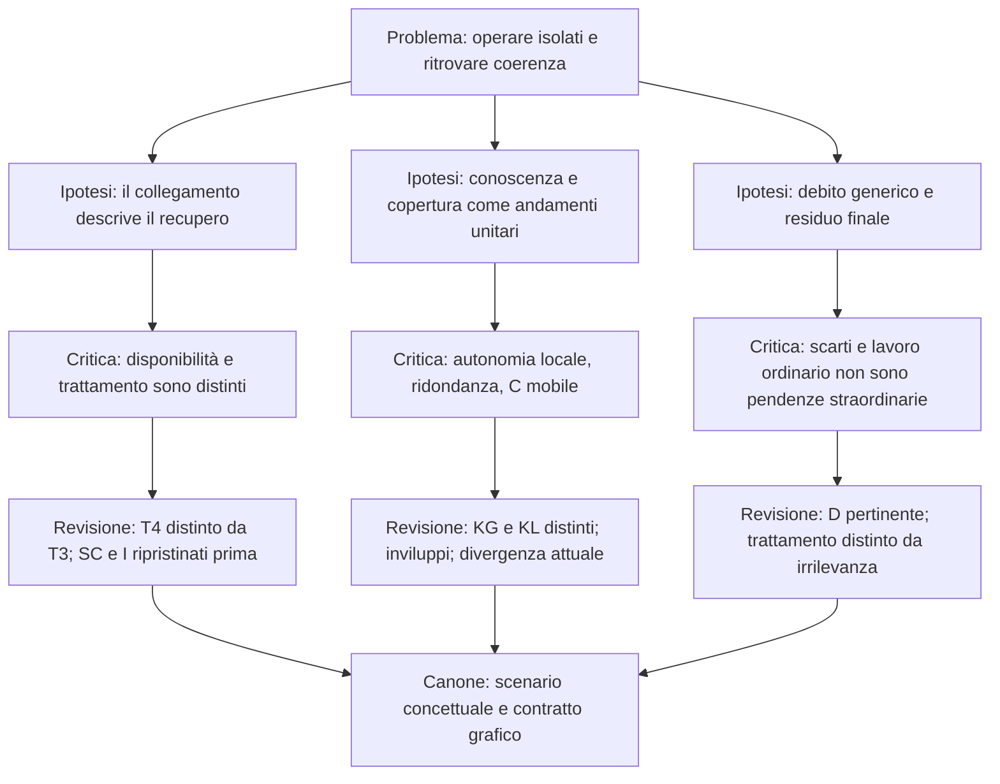
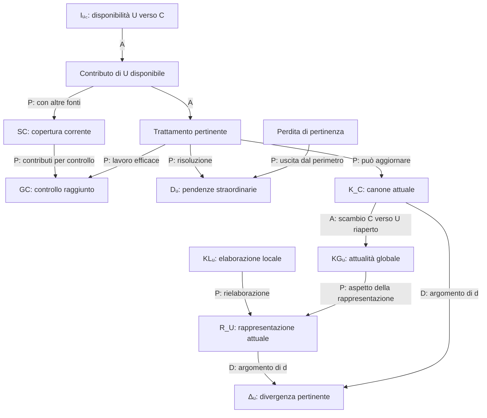

# Modello M1 — Stress test epistemologico popperiano

**4 ottobre 2026 · Esame della Genealogia del 2 ottobre e del Canone del 3 ottobre 2026**

## Esito principale

M1 è soprattutto uno **schema analitico dinamico e un modello concettuale euristico**, accompagnato da un contratto di rappresentazione. È sufficientemente articolato per distinguere problemi che una descrizione indifferenziata della disconnessione confonderebbe; non costituisce ancora una teoria empirica capace di derivare e mettere alla prova la traiettoria rappresentata. La genealogia documenta autentiche eliminazioni di errori concettuali. Non documenta, invece, una successione di confutazioni sperimentali né una corroborazione empirica del modello.

Il punto più vulnerabile è la possibile **trasformazione di un percorso selezionato e di una conclusione definita mediante il successo in una spiegazione o previsione del successo stesso**. Il Canone contiene cautele esplicite contro questo passaggio. Rispettarle preserva la legittimità del modello, ma circoscrive anche ciò che esso può rivendicare.

## 0. Corpus, riferimenti e metodo

Ho letto integralmente i due documenti, incluse tutte le appendici. Uso queste sigle:

| Sigla | Documento | Funzione nell’esame |
| --- | --- | --- |
| **G** | *Frontiera-M1-Genealogia-Ritorno-alla-coerenza.md*, 2 ottobre 2026, 409 righe nella restituzione consultata | Storia delle formulazioni e delle revisioni; non autorità sullo stato successivo |
| **C** | *Frontiera-M1-Canone-Modello.md*, 3 ottobre 2026, 356 righe | Autorità per lo stato finale, comprese le appendici vincolanti |
| **Z** | *A4 - grafici.zip*, cinque elementi ispezionati | Riscontro dei concept anteriori; non sostituisce il Canone |

I rinvii «C §5, GC» o «G §8.3» indicano il punto preciso della fonte; per le sezioni con più variabili nomino anche il sottotitolo. **Ricostruzione**, **valutazione critica** e **proposte di test** sono tenute distinte. Nessuna formula operativa proposta in questo rapporto viene attribuita retroattivamente a M1.

La storia disponibile ha un limite documentale dichiarato: G è una ricostruzione basata in parte su riassunti datati, non sulle trascrizioni complete; lo stesso vale per i recuperi finali citati da C. Posso giudicare la genealogia documentata, non certificare la prima invenzione assoluta di ogni concetto o l’esaustività dei dialoghi. [G, Nota sulle fonti, §11 e App. C; C, App. B]

Z conferma GC come vecchia curva singola, SC ripristinato in T3 e D azzerato in T4. Il Canone prescrive invece GC come inviluppo. Il PNG 2A presenta inoltre minimi apparentemente anticipati rispetto a T3: non li tratto come revisioni teoriche, perché G §9.2 esplicita il contrasto fra rendering e vincolo. Lo ZIP non contiene il Panel 1 originario.

Il riferimento metodologico è ai testi di Popper elencati in fondo, non a una sua presunta autorità risolutiva. Una conferma conta quando un tentativo serio di confutazione fallisce; una definizione non diventa un’ipotesi empirica per il fatto di comparire in una formula. Le modifiche sono valutate per i problemi che risolvono e per le nuove possibilità di critica che aprono. Non assumo che la misurazione debba essere numerica: anche una previsione qualitativa precisa può escludere osservazioni possibili. [P1–P3]

## 1. Ricostruzione fedele prima della critica

### 1.1 Il problema

Come rappresentare la separazione e il successivo ritorno alla coerenza di due processi conoscitivi che continuano entrambi a svilupparsi? U perde il collegamento con C, conserva informazioni e conosce localmente; C continua a evolvere senza il contributo di U. Tornare a comunicare rende possibile una riconciliazione che richiede lavoro ulteriore. Il problema non è la semplice riaccensione di una rete, né la sostituzione di una copia arretrata con un originale immutabile. [C §1; G §§1–2 e 7]

M1 segue **un episodio**, dalla condizione iniziale di riferimento a una riconciliazione pertinente conclusa. Non afferma che ogni isolamento debba seguire quelle curve, né che ogni sistema raggiunga quella conclusione entro un tempo dato. [C §§1–3, 10–11]

### 1.2 Oggetti, variabili e statuto delle grandezze

La colonna finale distingue ciò che il testo definisce da possibili accessi osservativi: questi ultimi non sono già strumenti validati da M1.

| Elemento | Significato canonico | Rappresentazione e accesso empirico possibile |
| --- | --- | --- |
| **C; K_C** | Quadro condiviso e suo contenuto attuale; può cambiare, anche ricevendo contributi da U | C è zero relativo nel Panel 1. Versioni e registri possono documentarne i contenuti; lo zero non è una misura di verità. [C §§1, 4] |
| **U; R_U** | Unità e sua rappresentazione attuale, attiva anche nell’isolamento | Archivi, osservazioni e decisioni locali possono lasciare tracce; la rappresentazione rilevante va delimitata. [C §§1, 4–5] |
| **Δᵤ** | Divergenza fra R_U e K_C: Δᵤ(t)=d(R_U(t),K_C(t)) | Costrutto relazionale; d e componenti non canonizzate. Non è conoscenza totale né debito. [C §4] |
| **GC** | Grado di controllo raggiunto: comprende verifica, confronto, corroborazione, falsificazione, deduplicazione, disambiguazione e classificazione | Inviluppo non probabilistico fra standard 0 e deficit possibile. Il risultato del controllo va inferito mediante criteri operativi ancora aperti. [C §5, GC; App. A.3–A.5] |
| **KGᵤ** | Attualità della conoscenza globale conservata e rielaborata da U | Curva singola relativa. Archivio, età e scarto attuale sono distinti; manca l’indicatore definitivo. [C §5, KGᵤ] |
| **KLᵤ** | Conoscenza prodotta ed elaborata localmente | Inviluppo di possibilità sopra/sotto zero. Tracce locali osservabili non equivalgono ancora a una scala del loro miglioramento o deterioramento. [C §5, KLᵤ] |
| **SC** | Copertura sensoriale effettiva corrente disponibile a C | Inviluppo del deficit. Disponibilità delle fonti e loro sovrapposizione sono osservabili con protocolli; la copertura effettiva richiede dominio e criterio. [C §6, SC] |
| **Iᵤ꜀** | Disponibilità del collegamento che consente il contributo U→C | Binario nello scenario; verificabile con tracce del canale a una risoluzione fissata. Non misura integrazione compiuta né tutti i flussi bidirezionali. [C §6, Iᵤ꜀] |
| **Dᵤ** | Lavoro pertinente irrisolto, straordinario rispetto alla baseline fisiologica e attribuibile all’isolamento | Pendenze e operazioni hanno tracce; attribuzione causale, pertinenza e unità di lavoro non sono ancora operazionalizzate. [C §6, Dᵤ; App. A.1–A.2] |

Il contratto grafico conta otto elementi: C e Δᵤ nel Panel 1; GC, KGᵤ e KLᵤ nel 2A; SC, Iᵤ꜀ e Dᵤ nel 2B. R_U e K_C specificano gli argomenti del confronto; P_C è una distinzione esplicativa, non una nona grandezza da disegnare. [C §§1, 4–5 e App. B]

### 1.3 Primitive, stipulazioni e conseguenze

M1 non presenta un sistema assiomatico completo. «Primitivo» indica qui ciò che il testo assume senza derivarlo, non un assioma formalmente enumerato.

| Livello | Elementi | Che cosa ne segue realmente |
| --- | --- | --- |
| **Struttura assunta** | Due attori distinti; un quadro condiviso; attività conoscitiva separata; canale interrompibile; possibilità di scambio e trattamento | Permette di formulare il problema della coerenza. Non implica da sola una divergenza monotona. [C §§1, 4–6] |
| **Definizioni e perimetri** | Divergenza pertinente; controllo; debito straordinario; distinzione perdita/pendenza; conclusione pertinente | Una pendenza ancora pertinente esclude la riconciliazione conclusa; perdita definitivamente classificata e lavoro ordinario non sono residui di Dᵤ. [C §§6, 10; App. A] |
| **Condizioni dello scenario** | Origine allineata; collegamento binario; fonte integra; andamento monotono scelto; estremi in T3; riferimenti finali in T4 | Restringono l’istanza rappresentata. Non sono dedotte dalle sole definizioni. [C §§2–3, 8–11] |
| **Convenzioni grafiche** | C a zero; scale separate; raccordi; apertura continua iniziale GC; KLᵤ aperto nel default | Determinano una resa leggibile, non nuove cause o leggi. [C §§2, 5, 8, 11] |
| **Conseguenze definitorie** | Dᵤ(T4)=0; T4 non dichiarabile con lavoro pertinente incompiuto | Vere entro il significato adottato di debito e conclusione; non previsioni indipendenti del futuro. [C §§6, 10–11] |
| **Relazione processuale accolta** | La lavorazione pertinente ed efficace che riduce Dᵤ sostiene il recupero o mantenimento di GC | È un impegno concettuale ulteriore, non un teorema ricavato dalla sola definizione di Dᵤ. La sola irrilevanza non basta. [C §7; App. A.4] |

L’etichetta **A** del Canone indica autorità concettuale interna. Non rende analitiche tutte le frasi così classificate: l’attività di U e la possibilità di modificare C sono assunzioni sull’architettura rappresentata, suscettibili di riscontro quando si identifica un sistema reale.

## 2. Rappresentazione A — Genealogia concettuale

Il diagramma mostra tre catene di problemi e revisioni che confluiscono nello stato canonico; le date dettagliate e i ritorni sui problemi sono nella tabella successiva.

Le «ipotesi» del diagramma sintetizzano formulazioni o ambiguità discusse: non implicano che gli autori abbiano sostenuto una teoria empirica unitaria con quelle parole.

| Passaggio documentato | Difficoltà e revisione effettiva | Destino nel Canone |
| --- | --- | --- |
| **T1–T3 → introduzione T4**, 22 settembre | Il ritorno del collegamento lascia duplicazioni e incompatibilità da trattare. Viene introdotta una fase distinta. [G §2.2] | Mantenuto; T4 riceve condizioni congiunte più precise. [C §§3, 10] |
| **GA/affidabilità → GC/corroborazione** | Accordo fra fonti non garantisce correttezza. La variabile viene separata da una certificazione di verità. Origine esatta di GA non attribuibile. [G §2.1] | GC è ampliato a controllo, mantenendo la rinuncia alla verità garantita. [C §5, GC; App. A.3] |
| **Conoscenza di U → KGᵤ/KLᵤ**, 22–29 settembre | Conservare dati, invecchiare e conoscere localmente non sono lo stesso processo; autonomia non implica disaccordo necessario. [G §§4.2–4.3] | Distinzione mantenuta; indicatore esponenziale non canonizzato; KLᵤ non deve chiudersi. [C §5] |
| **Fonte persa → inviluppo SC**, entro 23–24 settembre | La ridondanza può conservare copertura. Una curva univoca attribuirebbe una perdita necessaria non giustificata. [G §5.1] | Mantenuto; iniziativa individuale non certificabile. [C §6, SC; G §11] |
| **Chiusura SC a T4 → chiusura a T3**, 24 settembre | Copertura corrente confusa con trattamento del pregresso; sensori integri possono tornare accessibili prima della riconciliazione. [G §5.2] | Chiusura istantanea condizionata allo scenario, non recupero del passato. [C §§3, 6] |
| **C orizzontale → zero mobile**, 26 settembre | Una baseline ferma rischiava di rappresentare una conoscenza immobile. [G §3.2] | Mantenuto; C può cambiare anche grazie a U. [C §§1, 4] |
| **Plateau/arcata e discesa pre-T3**, 24–28 settembre | La geometria anticipava o interrompeva la divergenza senza specificarne il meccanismo. L’arcata è ribadita. [G §3.3] | Massimo T3; T2 non causale. Scelta dello scenario, non confutazione dei plateau reali. [C §§3–4] |
| **I come integrazione corrente → disponibilità**, 29 settembre | La variabile confondeva possibilità di trasmettere e integrazione effettuata. [G §5.3] | Definizione aggiornata; grafico binario conservato, referente U→C. [C §6, Iᵤ꜀] |
| **D=0 → residuo → Dᵤ(T4)=0**, 24 settembre–1 ottobre | Il residuo riaperto nelle discussioni contraddice la conclusione delle pendenze nello stesso perimetro. [G §§8.1–8.3] | Residuo escluso; lavoro fisiologico esplicitamente separato. [C §6; App. A.1–A.2] |
| **Errore scoperto come peggioramento GC → controllo riuscito**, 2 ottobre | Si confondevano falsità del contenuto e funzionamento del controllo. [G §4.1] | Correzione mantenuta; GC comprende anche falsificazione e classificazione. [C §5; App. A.3–A.4] |
| **Componente corroborativa proposta → controllo ampio**, consolidamento 3 ottobre | La separazione fra lavoro corroborativo e lavoro «altro» non basta a descrivere deduplicazione, disambiguazione e falsificazione. [G §§4.1, 11; C App. A.4] | Non conservata come partizione canonica autonoma; decisiva la causa della riduzione del debito. |
| **GC curva → inviluppo** | Il controllo può essere preservato da compensazioni. Il recupero citato dal Canone attesta l’inviluppo già il 1º ottobre, benché G non lo riporti. [C App. B] | GC fra deficit possibile e standard; massimo di apertura T3 e chiusura T4. [C §5; App. A.5] |

Non tutti i cambiamenti aumentano il contenuto empirico. Alcuni eliminano confusioni; altri restringono lo scenario; altri allargano le possibilità ammesse. La tabella evita di trasformare questa storia in una progressione lineare di predizioni sempre più severe.

## 3. Rappresentazione B — Architettura canonica

### 3.1 Relazioni e dipendenze

Nel diagramma **D** significa nesso definitorio; **P** nesso processuale qualitativo; **A** abilitazione. Nessuna freccia è un coefficiente causale misurato. Il trattamento è un processo esplicativo, non una nuova curva canonica.

La direzione dei flussi è rilevante: il recupero KGᵤ usa lo scambio C→U, assunto nella riconciliazione complessiva, ma **non dedotto dalla sola definizione di Iᵤ꜀**, che riguarda U→C. Inoltre, l’uscita per irrilevanza riduce Dᵤ senza una freccia automatica verso GC. [C §§1, 5–7; App. A.4]

GC non è una funzione già definita di SC o Dᵤ; Δᵤ non è la loro somma. L’architettura espone una decomposizione intelligibile dei fenomeni, non un sistema di equazioni dinamiche chiuso. [C §§1, 7, 11]

### 3.2 Sequenza e condizioni iniziali

| Fase | Collegamento/copertura | Conoscenza e controllo | Divergenza/debito |
| --- | --- | --- | --- |
| **T0–T1** | I=1; SC al riferimento | KG al riferimento; GC e KL graficamente chiusi | Δ=0; D=0 straordinario. Può esistere lavoro fisiologico |
| **T1, subito dopo** | I passa a 0; bordo basso SC salta sotto zero | GC e KL iniziano ad aprirsi; KG inizia a perdere attualità | Δ e D partono da 0; non identità epistemica C/U |
| **T1–T3, incluso T2** | I=0; SC ammette deficit crescente o copertura preservata | KG scende; fascia GC si amplia; KL ammette sviluppi diversi | Δ e D crescono nello scenario; T2 non cambia regime |
| **T3** | I torna a 1; SC chiude a zero con fonte integra | KG minimo; GC massima apertura e inizio recupero; KL senza evento obbligatorio | Δ e D al massimo positivo; nessuna cancellazione istantanea del lavoro |
| **T3–T4** | I e SC ripristinati | KG risale; GC si restringe; KL continua | Δ e D diminuiscono; riduzione D per trattamento o irrilevanza |
| **T4** | Collegamento e copertura disponibili | KG al riferimento; GC allo standard; KL aperto ammesso | Δ=0 e D=0 nel perimetro pertinente; non recupero integrale del passato |

Fonte: C §§3, 8–10. Gli inviluppi descrivono possibilità alternative: il bordo inferiore SC raggiunge il minimo a **T3⁻**, prima del salto; non è il valore a destra di T3. Una fascia GC aperta non obbliga il controllo effettivo di ogni caso a essere deteriorato.

### 3.3 Osservabile, inferito, teorico

La distinzione non coincide con «misurabile/non misurabile». Tempi di messaggi, versioni, pacchetti e operazioni sono registrabili, ma diventano evidenza mediante interpretazioni e controlli. SC richiede un criterio di copertura; Dᵤ richiede classificazione e attribuzione rispetto a una baseline; GC richiede una valutazione del controllo raggiunto; Δᵤ e KGᵤ richiedono criteri di confronto. Gli inviluppi richiedono una classe di possibilità. M1 non offre ancora queste procedure in forma sufficiente a produrre misure confrontabili fra osservatori. [C §§4–6, 11]

Le componenti non direttamente osservabili non sono per questo illegittime. Il problema è se le regole che le collegano alle osservazioni possano essere fissate e criticate indipendentemente dal risultato che si vuole ottenere.

## 4. Statuto epistemologico

| Categoria | Valutazione | Motivo |
| --- | --- | --- |
| **Teoria empirica** | Non ancora, come sistema complessivo | Mancano dominio empirico selezionabile indipendentemente dall’esito, regole di misura e leggi di collegamento capaci di derivare il profilo. [C §§1–2, 11] |
| **Modello teorico** | Sì, in senso concettuale e idealizzato | Rappresenta oggetti e processi mediante selezioni e idealizzazioni esplicite; non è un modello matematico dinamico chiuso. [C §§1, 7–8] |
| **Schema analitico** | Statuto principale | Distingue disponibilità, copertura, attualità, controllo, divergenza e lavoro pendente. [C §§4–7] |
| **Formalizzazione concettuale** | Sì, parziale | Notazione, condizioni ed esclusioni sono precise; metrica, unità e leggi restano aperte. [C §§4, 10–11] |
| **Modello euristico** | Sì, con fertilità concreta | Suggerisce dove cercare ritardi, conflitti, compensazioni e ambiguità di misura. [C §§6–7] |
| **Struttura descrittiva** | Sì, per un episodio selezionato | Stabilisce come rappresentare la separazione e il ricongiungimento pertinenti. [C §§1–3, 8–10] |

La combinazione appropriata è dunque **schema analitico e modello concettuale dinamico, euristico e parzialmente formalizzato, con ipotesi empiriche potenziali**. L’assenza di falsificabilità diretta delle convenzioni non lo rende pseudoscientifico. Sarebbe metodologicamente scorretto rivendicare corroborazione empirica per le sue sole definizioni o per la conformità di un disegno al contratto.

Nemmeno la mancanza di numeri è il difetto decisivo: «il recupero corrente precede la risoluzione di determinate pendenze» potrebbe essere un’ipotesi qualitativa testabile. Occorrono però criteri indipendenti per riconoscere eventi, pendenze e dominio di applicazione.

## 5. Stress test: che cosa viene escluso?

Nella tabella, **falsificatore condizionale** significa un esito incompatibile con l’applicazione empirica della proposizione, dopo averne fissato interpretazione e condizioni. Non significa che un fatto reale possa confutare una convenzione grafica come tale.

| Proposizione e punto preciso | Stati esclusi / possibile risultato contrario | Contenuto e potere discriminante attuali |
| --- | --- | --- |
| **C è rappresentato a zero** [C §4, C] | Un grafico con C spostato viola la convenzione; nessuno stato reale è escluso dalla scelta dell’origine | Non empirica. Il cambiamento del contenuto di C è compatibile con lo zero |
| **C e U proseguono attività separate** [C §1; §5, KLᵤ] | In un’applicazione, completa cessazione documentata dell’attività locale contraddice questa premessa | Assunzione strutturale controllabile; restringe l’applicabilità, non legge su tutte le unità scollegate |
| **Δ cresce fino a T3 e poi scende** [C §4, Andamento] | Convergenza durante isolamento; massimo prima o dopo T3; nuova crescita dopo T3 | Esclusioni ordinali reali una volta fissata d; attualmente il profilo è selezionato, non derivato |
| **KG perde attualità fino a T3** [C §5, KGᵤ] | U anticipa con inferenze locali l’aggiornamento di C; attualità stabile o crescente | Testabile come ipotesi applicativa; il testo esclude espressamente la necessità universale del calo |
| **KL può migliorare, peggiorare o coincidere** [C §5, KLᵤ] | Nessuno dei tre andamenti è escluso; soltanto limiti operativi indipendenti potrebbero vietare alcuni esiti | Debole contenuto predittivo locale. Distingue autonomia da inattività, ma la fascia non assegna frequenze o limiti misurati |
| **La fonte U è persa; la copertura può essere preservata** [C §6, SC] | Perdita o conservazione della copertura sono entrambe ammesse | La disgiunzione è poco rischiosa. Diventa discriminante se la ridondanza è specificata prima e usata per predire quale caso avverrà |
| **SC torna al riferimento in T3** [C §§3, 6, SC] | Fonte integra e canale disponibile, ma persistente deficit corrente oltre la tolleranza temporale fissata | Ipotesi applicativa rischiosa; l’istantaneità esatta è un’idealizzazione e richiede una risoluzione osservativa |
| **I è binario e vale 1 da T3** [C §6, Iᵤ꜀] | Collegamento parziale, intermittente o asimmetrico | Falsifica l’adeguatezza dell’idealizzazione a quel caso; se T3 è definito dalla disponibilità, I(T3)=1 non è una previsione autonoma |
| **D cresce fino a T3, cala dopo** [C §6, Isolamento/Riconciliazione] | Scadenze riducono D prima di T3; verifiche fanno emergere nuove pendenze dopo T3 | Forte esclusione se D è misurato con regole fisse; il Canone la presenta come bilancio netto scelto |
| **I=1 non implica D=0** [C §§6–7] | La distinzione logica non viene confutata da un caso senza arretrato; quel caso è compatibile con due concetti diversi | Un caso con I=1 e D>0 smentisce il modello rivale che li identifica; non corrobora tutte le curve di M1 |
| **GC può restare allo standard durante isolamento** [C §5, GC] | Peggioramento e mantenimento sono ammessi | La possibilità non offre una previsione per il singolo caso; servono condizioni di compensazione indipendenti |
| **Il trattamento efficace sostiene GC** [C §7; App. A.4] | Trattamento giudicato efficace indipendentemente da GC, seguito da peggioramento persistente del controllo, a condizioni fissate | Potenziale principale ipotesi di processo; tautologica se «efficace» significa soltanto «produce GC↑» |
| **D↓ per irrilevanza non implica GC↑** [C §7; App. A.2–A.4] | Un miglioramento GC dopo scadenza non confuta la negazione dell’implicazione necessaria | Distingue cause possibili. L’effetto differenziale fra trattamento e scadenza va ancora specificato |
| **D(T4)=0 e condizioni congiunte finali** [C §§10–11] | Una pendenza pertinente al presunto T4 mostra che l’etichetta T4 è stata applicata male | Criterio di conclusione, non previsione che la conclusione avverrà. Nessuna scadenza di arrivo è fissata |
| **Riconciliazione bidirezionale** [C §§1, 6–7] | Un’architettura incapace di accettare qualsiasi contributo U→C non realizza la reciprocità assunta | Capacità del sistema controllabile. Nessuna modifica effettiva di C in un singolo episodio non confuta «C può acquisire» |
| **Nessuna funzione algebrica fra pannelli è definita** [C §§1, 7, 11] | Non è l’affermazione empirica che nessuna funzione possa mai esistere | Dichiarazione di incompletezza. Non va trasformata in indipendenza causale dimostrata |

### 5.1 Tre distinzioni indispensabili

**Non falsificato** significa che una determinata ipotesi non è stata respinta dai test eseguiti; senza test seri, questo stato può essere scarsamente informativo. **Verificato**, se inteso come verità definitivamente provata di una legge generale, non segue da una serie finita di successi. **Vero** riguarda come stanno le cose, non il numero di controlli superati. La corroborazione è una valutazione dei risultati di test severi, non una probabilità che la teoria sia vera. [P1–P2]

Nel corpus non sono riportati test empirici di M1. La formulazione corretta è quindi **«non empiricamente corroborato nei documenti esaminati»**. Dire soltanto «finora non confutato» suggerirebbe un confronto sperimentale non documentato.

### 5.2 GC non è la corroborazione popperiana del modello

GC descrive il controllo di un quadro informativo *dentro* il sistema. La corroborazione popperiana riguarda come un’ipotesi ha resistito a tentativi di confutazione. Aumentare GC tramite deduplicazione o classificazione non costituisce automaticamente un test severo di M1. Analogamente, falsificare una voce di C non falsifica M1, mentre scoprire un errore può mostrare che una procedura di controllo ha funzionato. [C §5, GC; App. A.3–A.4]

Resta possibile una differenza fra **qualità del processo appena eseguito**, **controllo effettivo del quadro** e **stima che ne abbiamo**. Scoprire una vulnerabilità può migliorare il processo conoscitivo e insieme abbassare la stima del controllo già raggiunto. C esclude correttamente il peggioramento *automatico* di GC quando si trova un errore; non fornisce ancora regole per separare questi tre livelli. Questa è una questione operativa aperta, non una contraddizione già dimostrata. [C §5, GC, Relazioni ed esclusioni; App. A.3–A.4]

## 6. Critica interna: coerenza, dipendenze, circolarità

### 6.1 Nessuna contraddizione necessaria fra i vincoli canonici

I seguenti stati possono coesistere senza incoerenza: I=1 con D>0; SC ripristinato con GC sotto standard; Δ=0 con KL aperto; D=0 straordinario con lavoro ordinario pendente. Sono precisamente le distinzioni che il Canone intende introdurre. [C §§5–7, 10]

Esiste inoltre una compatibilità geometrica elementare: si possono disegnare un’arcata Δ e un’arcata D fra T1 e T4, una curva KG speculare soltanto nella forma qualitativa, fasce GC e SC con chiusure diverse e una fascia KL aperta. Non serve identificarne le scale. **Questo attesta la soddisfacibilità dei vincoli grafici, non la consistenza di una teoria matematica completa né la realizzabilità empirica congiunta di quelle traiettorie.** [C §§2, 8–11]

### 6.2 La distanza zero e la coerenza pertinente

**Punto:** C §4 definisce Δ=d(R_U,K_C), menziona distanza euclidea e aggregazioni, ma consente Δ=0 senza uguaglianza di tutti i contenuti.

**Problema:** se d fosse una metrica autentica applicata alle rappresentazioni complete, distanza zero implicherebbe identità dei suoi argomenti. La distinzione degli atti non crea un problema: due attori possono produrre lo stesso contenuto. Il problema emerge invece se i *contenuti inclusi negli argomenti* restano diversi e d viene comunque detta metrica con valore zero.

**Valutazione:** non è una contraddizione attuale, perché d è aperta e il testo parla di pertinenza. È una biforcazione da risolvere prima della misura. Possibili sviluppi, qui soltanto proposti: confrontare proiezioni su contenuti pertinenti; usare una pseudometrica; definire una relazione di equivalenza operativa. Scegliere una di queste opzioni cambierà ciò che Δ esclude e dovrà avvenire prima dei risultati.

### 6.3 Lo sviluppo separato non implica divergenza crescente

**Punto:** G §3.3 motiva l’arcata mediante l’attività di entrambi gli attori; C §4 ne conserva la crescita monotona come vincolo B.

**Problema:** due rappresentazioni autonome possono allontanarsi, restare alla stessa distanza o convergere, anche mentre entrambe cambiano. Un plateau richiede una spiegazione se lo si vuole sostenere causalmente; anche l’aumento continuo richiede una spiegazione. L’assenza di un meccanismo esplicitato per il primo non dimostra il secondo.

**Valutazione:** la motivazione genealogica seleziona una narrazione plausibile, non una deduzione. C evita il salto logico qualificando il profilo come scenario. Una successiva lettura dell’arcata come necessità dell’isolamento reintrodurrebbe l’errore.

### 6.4 SC corrente e deterioramento nel tempo

**Punto:** C §6, SC prescrive un salto iniziale e un ulteriore peggioramento possibile della copertura corrente durante l’isolamento; G §5.1 lo collega al mancato aggiornamento.

**Problema:** se SC misura soltanto geometria e disponibilità istantanea di sensori invariati, il deficit potrebbe stabilizzarsi dopo il salto. Se misura invece la freschezza della rappresentazione osservativa, il peggioramento progressivo è intelligibile, ma richiede una regola che lo distingua da KG e GC.

**Valutazione:** ambiguità del criterio di misura, non identità fra le variabili. Occorre specificare se «effettiva» comprenda età delle osservazioni, movimento del campo, mutamento dei requisiti o combinazioni determinate. Il vecchio concept Funzione SC già dichiara deterioramento progressivo e assenza di compensazione sufficiente come assunzioni: non le prova. [Z, Funzione SC.png]

### 6.5 Un collegamento orientato non prova la disponibilità inversa

**Punto:** C §6 limita esplicitamente Iᵤ꜀ al contributo U→C; C §§1 e 5 descrive anche aggiornamento C→U.

**Problema:** Iᵤ꜀=1 non è da solo condizione sufficiente per KGᵤ in recupero: servono disponibilità del canale inverso, ricezione e capacità di elaborazione.

**Valutazione:** l’assunzione bidirezionale è presente nel racconto, quindi non manca ogni giustificazione. Manca la sua rappresentazione operativa. Non è necessario aggiungere subito una variabile, ma un’applicazione deve registrare quella condizione ausiliaria.

### 6.6 Dᵤ: attribuzione e baseline

**Punto:** C §6 e App. A.1 definiscono un’eccedenza di lavoro pertinente attribuibile all’isolamento senza dare una formula per la baseline.

**Problema:** due osservatori possono attribuire lo stesso lavoro rispettivamente all’isolamento, alla normale evoluzione del sistema o a un problema preesistente. Il conteggio delle pendenze note può aumentare dopo T3 perché solo allora si scoprono conflitti già latenti. Inoltre «eccedenza rispetto al fisiologico» e «lavoro con provenienza nell’episodio» sono criteri connessi ma non automaticamente identici.

**Valutazione:** la distinzione concettuale è valida; la misura causale è sottospecificata. Occorre distinguere debito esistente e debito conosciuto, registrare provenienza e stabilire il controfattuale ordinario. Non è lecito sostituire senza dichiararlo Dᵤ con il semplice arretrato totale o con una differenza fra due conteggi.

### 6.7 La possibile circolarità di R ed efficacia

**Punto:** C App. A.4 accoglie Dᵤ↓ per lavorazione pertinente ed efficace ⇒ GC↑, oppure mantenimento dello standard.

**Problema:** se l’efficacia è riconosciuta solo quando GC migliora, la relazione ripete il criterio con cui si assegna R. Nessun trattamento con GC peggiorato conterebbe mai come antecedente vero.

**Valutazione:** il testo non obbliga a questa circolarità, ma non fornisce un criterio indipendente che la impedisca. Se R viene certificato tramite correttezza locale delle operazioni e GC tramite un audit separato, la relazione acquista rischio empirico. Se invece è una definizione di «efficace rispetto al controllo», rimane legittima ma perde il ruolo di spiegazione causale. La clausola del mantenimento allo standard è ragionevole; senza regole per riconoscere il contributo marginale rende però deboli i test sui casi già saturi.

### 6.8 T4: coerenza definitoria e rischio di successo incorporato

**Punto:** C §10 richiede insieme Δ=0, D=0, GC allo standard, KG al riferimento, SC ripristinata e I attivo; non fissa un tempo reale di arrivo.

**Problema:** osservare queste proprietà in T4 non testa una previsione se T4 viene identificato cercando proprio quelle proprietà. Osservare D>0 a un’ora scelta non confuta D(T4)=0: dimostra che quell’ora non soddisfa il criterio.

**Valutazione:** definizione utile di stato conclusivo, senza circolo vizioso finché non pretende di spiegare l’arrivo. Neppure la simultaneità grafica dei riferimenti finali dimostra che i rispettivi primi tempi di recupero coincidano. Per testare una previsione servono un orizzonte e un criterio esterno, oppure una legge sui tempi di primo raggiungimento. Un ritorno solo asintotico solleva anche il problema degli zeri esatti e delle tolleranze.

### 6.9 Gli inviluppi hanno bisogno di un dominio

**Punto:** C §§5–6, 8 descrive possibilità non probabilistiche e lascia le ampiezze illustrative.

**Problema:** non è definita la classe di sistemi, configurazioni o traiettorie sulla quale si calcolano gli estremi. Un insieme di possibilità a ciascun istante non specifica automaticamente quali sequenze complete siano realizzabili: una traiettoria potrebbe collegare punti che appartengono a configurazioni incompatibili.

**Valutazione:** il testo non afferma che qualsiasi sequenza interna sia possibile, quindi non gli attribuisco tale errore. Tuttavia, per fare previsioni gli inviluppi devono vincolare traiettorie o configurazioni determinate. L’assenza di probabilità è legittima; l’assenza di limiti empiricamente fissati ne riduce il potere discriminante.

## 7. Critica esterna: corroborazione, predizioni, semplicità

### 7.1 Conferme deboli e test severi

| Confronto | Valore epistemico |
| --- | --- |
| Ridisegnare i pannelli e controllare che rispettino C §§8–9 | Verifica del contratto grafico; nessuna corroborazione empirica |
| Scegliere un episodio concluso bene e chiamare T4 il momento del successo | Descrizione compatibile; forte selezione sull’esito |
| Osservare un ritardo generico dopo riconnessione | Conferma poco discriminante: molte spiegazioni di trasmissione, coda o elaborazione lo prevedono |
| Trovare un caso con I=1 e D>0 | Confuta l’identificazione semplicistica disponibilità=riconciliazione, se D è riconosciuto indipendentemente; non prova il resto di M1 |
| Fissare prima dominio, indicatori ed estremi, poi misurare episodi nuovi | Test rischioso dell’applicazione empirica della traiettoria |
| Ridurre D in due modi diversi e valutare GC indipendentemente | Test della distinzione trattamento/irrilevanza e della relazione processuale |
| Predire recuperi separati di SC e GC controllando la capacità di elaborazione | Confronto discriminante con un modello che riduce il ritardo alla sola rete |

Una sorpresa informativa deve essere relativa a un’aspettativa concorrente esplicita. Per esempio, se un modello basato sulla sola disponibilità del canale prevede recupero completo, SC ripristinato ma GC ancora compromesso sotto audit è informativo. Se ogni concorrente prevede già quel ritardo, l’osservazione non distingue M1. [Applicazione critica di P1 a C §§6–7]

### 7.2 Le predizioni più rischiose, se rese empiriche

Le esclusioni più forti sono: assenza di convergenza prima di T3; picco di D esattamente alla riconnessione; ripristino corrente SC entro una tolleranza prefissata; effetto del trattamento efficace su GC distinguibile da quello della sola perdita di pertinenza. Le prime tre derivano dal profilo B; l’ultima dall’impegno processuale di App. A.4.

La genealogia non documenta che M1 abbia anticipato un fenomeno successivamente osservato e non usato nella sua costruzione. Non è nemmeno corretto chiamarlo senz’altro adattamento post hoc a dati: nel corpus manca proprio una serie empirica cui sia stato adattato. È soprattutto una costruzione e revisione concettuale. La prova di novità sarebbe applicare una specificazione congelata a episodi nuovi, includendo quelli che non raggiungono T4. [G §§1–11; C §§1–2, 11]

### 7.3 Semplicità come testabilità

Separare I, SC, D e GC è giustificato perché rende concepibili osservazioni discriminanti: stesso canale ma diverso lavoro; stessa copertura ma diverso controllo; stesso debito ma diversa causa della sua diminuzione. Eliminare tali distinzioni impoverirebbe le domande possibili. [C §§6–7]

La separazione Δ/KG è invece empiricamente da dimostrare: se un’operazionalizzazione li calcolasse dallo stesso scarto con una trasformazione monotona, una delle due curve potrebbe essere ridondante per la previsione. Il testo ne distingue le intenzioni semantiche, ma non specifica componenti sufficienti a decidere il caso. [C §§4–5, KGᵤ; §11]

T2 non aumenta il contenuto empirico: serve alla lettura. Non è un parametro causale superfluo finché resta un marcatore; lo diventerebbe se gli si attribuisse un regime non giustificato. [C §3, T2]

Gli inviluppi aumentano la fedeltà concettuale rispetto a una curva che impone un unico esito; se lasciati indefiniti, ammettono però più esiti e riducono la severità del confronto. **Più variabili non equivalgono a più spiegazione; meno variabili non equivalgono a maggiore semplicità popperiana.** La domanda è quali alternative empiriche la struttura riesca a escludere con assunzioni controllabili. [C §§5–7, 11; P2, §§31–46, 82–83]

## 8. Ipotesi ausiliarie e rischio di immunizzazione

| Punto vulnerabile | Uso legittimo | Stratagemma immunizzante |
| --- | --- | --- |
| **Dominio dello scenario** [C §§1–2, 11] | Selezionare prima i sistemi cui applicare il profilo, usando condizioni indipendenti dall’esito | Dopo ogni anomalia dichiarare che «non era il tipo di episodio rappresentato», pur avendo prima rivendicato generalità |
| **d e pesi** [C §4; §11] | Scegliere una distanza giustificata dal compito; valutare una nuova versione su nuovi episodi | Cambiare pesi finché riappaiono arcata e massimo T3, mantenendo il nome della vecchia ipotesi |
| **Pertinenza** [C §6, Dᵤ; App. A.2] | Applicare scadenze o criteri di missione stabiliti e registrati | Dichiarare irrilevanti le sole pendenze che impediscono il risultato atteso |
| **Baseline fisiologica** [C App. A.1] | Stimarla da condizioni di riferimento indipendenti; distinguere variazioni reali del carico | Trasferire nell’ordinario ogni residuo scomodo dopo averlo osservato |
| **Efficacia R** [C App. A.4] | Certificare operazioni con criteri indipendenti da GC e controllare interferenze | Chiamare efficace solo il lavoro seguito da GC↑, quindi presentare la freccia come scoperta |
| **Standard GC e limiti delle fasce** [C §5, GC; §11] | Fissare standard e dominio prima dei test, distinguendo saturazione dell’indice e miglioramento reale | Spostare standard o ampliare fasce per assorbire ogni valore inatteso |
| **T4** [C §10] | Usarlo come definizione di conclusione; dichiarare separatamente se e quando è raggiunto | Presentare «non è ancora T4» come risposta a una previsione mancata di recupero che si pretende universale |
| **Sensoristica integra e ripristino** [C §3, T3] | Diagnosticare guasti, latenza e disponibilità dei flussi con prove indipendenti | Inventare un guasto nascosto esclusivamente per respingere un risultato contrario |

Il rischio non dimostra che gli autori abbiano usato queste strategie. La genealogia mostra soprattutto discussione di obiezioni concettuali, senza dati contrari occultati o aggiustamenti a misure. Inoltre C dichiara apertamente molte limitazioni: una restrizione annunciata prima del confronto non è una fuga retroattiva.

Una nuova ipotesi ausiliaria è feconda se identifica un meccanismo autonomamente controllabile e cambia ciò che ci si aspetta in altri casi. Per esempio, introdurre una latenza di validazione misurata può spiegare un recupero SC ritardato e predire l’effetto di aumentare risorse; chiamare semplicemente «non effettiva» ogni copertura che recupera tardi non aggiunge un controllo. La revisione deve essere trattata come una nuova specificazione da riesaminare, non come prova che quella precedente aveva sempre ragione. [P2, §20]

## 9. La genealogia come P₁ → TT → EE → P₂

Lo schema popperiano comprende eliminazione dell’errore mediante discussione critica, non soltanto esperimenti. È quindi applicabile anche alla costruzione concettuale di M1. La domanda ulteriore è *quale conoscenza sia cresciuta*: chiarezza e articolazione del problema oppure conoscenza empiricamente controllata del mondo. [P3]

| P₁: problema | TT: soluzione tentata | EE: critica ed eliminazione | P₂: problema nuovo | Giudizio |
| --- | --- | --- | --- | --- |
| Descrivere il ritorno del sistema | Schema fino alla riconnessione | Il canale riaperto non tratta il pregresso | Definire conclusione e lavoro residuo | **Progresso concettuale sostanziale**: T4 rende visibile un fenomeno prima compresso. [G §2.2; C §3] |
| Rappresentare la qualità di C | Affidabilità/concordanza | Concordanza non garantisce correttezza | Definire controllo e suoi risultati | **Eliminazione di un’inferenza ingiustificata**, non conferma sperimentale. [G §2.1; C §5, GC] |
| Rappresentare U isolata | Conoscenza non abbastanza differenziata | Archivio, età, scarto e produzione locale possono divergere | Misurare attualità senza confonderla con anzianità | **Aumento dell’articolazione concettuale e dei confronti possibili**. [G §§4.2–4.3; C §5] |
| Descrivere perdita di una fonte | Calo univoco di copertura | Altre fonti possono compensare | Stabilire quando la ridondanza è sufficiente | **Correzione valida**, ma fascia più permissiva finché mancano condizioni discriminanti. [G §5.1; C §6, SC] |
| Fissare recupero SC | Chiusura a T4 | Copertura corrente e trattamento storico sono diversi | Specificare condizioni del ripristino corrente | **Revisione effettiva del referente e dei tempi**, con una nuova ipotesi applicativa. [G §5.2; C §§3, 6] |
| Leggere C e Δ | C fermo/plateau ambiguo | Zero non significa immobilità; discesa anticipata significa convergenza | Giustificare forma e metrica | **Chiarimento riuscito dello zero; scelta di scenario per l’arcata**. Non viene provata la necessità del suo andamento. [G §§3.2–3.4; C §4] |
| Definire I | Integrazione corrente attiva | Possibilità e operazione compiuta sono diverse | Separare canale, ricezione e trattamento | **Eliminazione di equivoco**, pur mantenendo identico il grafico. [G §5.3; C §6, I] |
| Trattare residui a T4 | Debito positivo nonostante riconciliazione compiuta | Se è ancora pertinente, la riconciliazione non è compiuta; se non lo è, non è più debito | Definire pertinenza e baseline senza opportunismo | **Riparazione di incompatibilità definitoria**. Lo zero finale è più coerente, non più predittivo. [G §8; C App. A.1–A.2] |
| Collegare errore e GC | L’errore scoperto peggiora automaticamente il controllo | Scoprire e trattare il falso può essere successo del controllo | Distinguere processo, stato e sua stima | **Correzione di categoria**, con nuova difficoltà di misura. [G §4.1; C §5, GC] |
| Collegare D e GC | Suddivisione fra corroborazione e lavoro «altro» | Anche classificare e deduplicare controlla; irrilevanza non equivale a trattamento | Definire R indipendentemente da GC | **Ampliamento concettuale fecondo**, ma rischio di causalità definitoria. [C §7; App. A.3–A.4; confronto G §11] |

La crescita della conoscenza è autentica in senso critico: vengono abbandonate inferenze o classificazioni che generavano problemi, e ne emergono altri più precisi. Non è soltanto cosmetica. Tuttavia **maggiore chiarezza non equivale automaticamente a maggiore contenuto empirico**. La sostituzione di una curva con una fascia amplia gli esiti ammessi; la definizione rigorosa di T4 risolve un’incoerenza togliendo allo zero finale l’apparenza di una previsione indipendente.

La vicenda dell’arcata va valutata con particolare sobrietà: G documenta una scelta già presente nella specifica del 24 settembre e nuovamente discussa il 26–28. Non documenta una sequenza lineare in cui un plateau empiricamente smentito viene sostituito da un’arcata corroborata. Analogamente, G non include tutti gli aggiornamenti poi recuperati in C: la fascia GC non va datata arbitrariamente come invenzione del 3 ottobre. [G §3.3; C App. B]

## 10. Mappa dei punti forti e vulnerabili

Le categorie possono sovrapporsi: una componente può essere concettualmente robusta e operativamente incompleta.

| Categoria | Elementi | Motivazione e limite |
| --- | --- | --- |
| **Robusti sul piano epistemologico** | Distinzione riconnessione/riconciliazione; copertura/controllo; perdita/pendenza; scoperta del falso/verità garantita | Bloccano inferenze invalide e consentono osservazioni differenziali. Non provano le dinamiche scelte. [C §§3, 5–7; App. A] |
| **Promettenti ma sottospecificati** | Relazione processuale D–GC; dipendenza della copertura dalla ridondanza; aggiornamento reciproco C/U | Indicano meccanismi plausibili, ma non condizioni sufficienti o effetti discriminanti già calibrati. [C §§1, 5–7] |
| **Non empirici, legittimi come strumenti formali** | Zero mobile; scale distinte; criteri di T4; convenzioni dei raccordi; T2 | Rendono leggibile e controllabile la rappresentazione. Non richiedono falsificabilità sperimentale propria. [C §§2–4, 8–10] |
| **Potenzialmente metafisici, secondo l’interpretazione** | Distinzione degli atti conoscitivi oltre l’uguaglianza dei contenuti | Se indica processi distinti, è una distinzione formale o architetturale; se afferma irriducibilità ontologica degli atti, richiede un argomento filosofico autonomo. Il corpus non obbliga a questa seconda lettura. [C §5, KLᵤ; §10; G §4.3] |
| **Esposti all’immunizzazione** | Pertinenza mobile; baseline adattabile; efficacia definita dal successo; T4 senza scadenza; fasce senza limiti operativi | Possono assorbire anomalie se usati retroattivamente. Il rischio non dimostra una pratica immunizzante già avvenuta. [C §§5–6, 10–11; App. A] |
| **Da operazionalizzare** | d, KG, GC, lavoro D e sua attribuzione, copertura SC, soglie e tolleranze temporali | Senza regole indipendenti osservazioni diverse possono ricevere la stessa descrizione o la stessa osservazione descrizioni opposte. [C §11] |
| **Adatti a test severi** | Picco D in T3; nessuna convergenza pre-T3; ripristino SC; trattamento efficace rispetto alla semplice scadenza | Escludono risultati riconoscibili quando dominio e criteri sono congelati. [C §§4–7; App. A.4] |

Non attribuisco a M1 idealismo ontologico, infallibilità del canone o identificazione della realtà con la conoscenza: i due documenti non li stabiliscono. Nemmeno chiamare C «canone» ne fa un’autorità epistemica incontestabile: il testo ne ammette cambiamento ed errori. [C §§1, 4–5]

**Controesempio di portata:** due attori possono riconciliarsi accettando lo stesso contenuto falso. M1 non lo esclude e quindi non viene confutato da questo caso. Il caso mostra però perché il ritorno alla coerenza non possa essere usato come misura autonoma di avvicinamento alla verità. Per quella conclusione serve un confronto ulteriore con risultati indipendenti dal consenso C/U. [C §4; §5, GC; §10]

## 11. Cinque tentativi attivi di confutazione

Questi sono **scenari teorici e protocolli possibili, non risultati sperimentali ottenuti**. Le previsioni di tipo B sono attribuite all’istanza canonica; la loro applicazione a un dominio reale costituisce un impegno aggiuntivo che va dichiarato. Nessun caso viene presentato come confutazione globale di tutte le definizioni di M1.

### 11.1 Convergenza autonoma durante l’isolamento

1. **Componente sotto attacco.** C §4: Δ cresce durante T1–T3 e non scende prima della riconnessione; C §5, KGᵤ esclude recupero anticipato nel profilo scelto.
2. **Esito contrario.** U e C osservano separatamente un ambiente che evolve in maniera prevedibile. U corregge inferenzialmente la propria rappresentazione; una distanza fissata prima del confronto diminuisce mentre tutti i canali restano interrotti. Può recuperare anche l’attualità globale pertinente.
3. **Ausiliarie possibili.** Un canale non rilevato; un’errata misura della distanza; una dinamica ambientale eccezionale; una diversa classe di scenari.
4. **Legittime/ad hoc.** Sono legittimi controlli indipendenti dei canali o una restrizione del dominio annunciata prima. Cambiare i pesi dopo il risultato o sostenere che ogni convergenza rivela per definizione una riconnessione è immunizzazione. Riconoscere che il caso non segue il profilo B è legittimo, ma impone di rinunciare all’estensione empirica che lo includeva.
5. **Conseguenza persistente.** Abbandonare crescita monotona e massimo T3 come previsione generale per quel dominio; mantenere la distinzione fra isolamento, attività e coerenza. Introdurre, in una nuova versione, condizioni controllabili per divergenza, plateau e convergenza.

Un controesempio matematico alla *pretesa deduzione* è immediato. Non è la metrica canonica di M1: assumiamo, soltanto per questo esempio, isolamento per 0≤s≤1, R_U(s)=s, K_C(s)=2s−s² e d=valore assoluto. Entrambe le rappresentazioni crescono, ma Δ=s(1−s): parte da zero, raggiunge il massimo a metà isolamento e torna a zero prima di qualsiasi scambio. Quindi attività separata non implica divergenza monotona. L’esempio non confuta la scelta dichiarata di un altro scenario.

### 11.2 La riconnessione produce un picco di lavoro successivo

1. **Componente sotto attacco.** C §6, Dᵤ: massimo esattamente T3 e diminuzione continua successiva.
2. **Esito contrario.** Dopo il ripristino, il confronto fra archivi rende visibili conflitti incrociati che richiedono nuove verifiche. Il lavoro straordinario pertinente aumenta fino a T3+τ prima di diminuire. Criteri e unità di lavoro sono fissati in anticipo.
3. **Ausiliarie possibili.** Il nuovo lavoro esisteva già ma era ignoto; è lavoro ordinario; il vero T3 è posteriore al ripristino fisico; la capacità di elaborazione è cambiata.
4. **Legittime/ad hoc.** La distinzione debito latente/debito conosciuto è legittima se viene definita prima, con un modo indipendente per stimare il primo. Controlli di carico sono legittimi. Riclassificare a posteriori ogni aumento come fisiologico o spostare T3 sul picco osservato rende il massimo una convenzione. Dichiarare un debito latente non misurabile salva una narrazione, non una previsione testata.
5. **Conseguenza persistente.** Il massimo in T3 va abbandonato per quel dominio. Il modello dovrebbe distinguere generazione, scoperta e risoluzione delle pendenze, oppure limitare esplicitamente il profilo ai casi senza emersione successiva netta. Non cade la nozione di Dᵤ straordinario.

### 11.3 Fonte integra e canale attivo, ma SC non recupera

1. **Componente sotto attacco.** C §3, T3 e §6, SC: ripristino corrente alla riconnessione con fonte ancora disponibile e sensoristica integra.
2. **Esito contrario.** U trasmette pacchetti nuovi e i sensori sono integri, ma un problema di sincronizzazione temporale o di coordinate rende le osservazioni inutilizzabili per coprire il campo corrente. SC, misurata come copertura effettivamente utilizzabile, resta sotto riferimento oltre la tolleranza prefissata.
3. **Ausiliarie possibili.** Latenza di trasporto, ricalibrazione, autenticazione, qualità dei metadati; oppure interpretare SC come mera disponibilità grezza.
4. **Legittime/ad hoc.** Una latenza o ricalibrazione misurata indipendentemente è una revisione produttiva se predice altri ritardi. La fonte è esclusa dal dominio senza immunizzazione se «disponibile» era già definito come pienamente utilizzabile. Se questo requisito viene introdotto solo dopo, si è modificata la condizione. Ridefinire SC come pacchetti ricevuti mantenendo invariata la precedente rivendicazione di copertura effettiva è equivoco protettivo.
5. **Conseguenza persistente.** Istantaneità e sufficienza di integrità più collegamento vanno riviste nell’applicazione. Può servire un intervallo di ripristino corrente distinto dal successivo controllo. La distinzione SC/GC sopravvive solo se i criteri non vengono sovrapposti per salvare i tempi.

### 11.4 Trattamento corretto senza recupero del controllo

1. **Componente sotto attacco.** C §7 e App. A.4: riduzione per lavorazione pertinente ed efficace sostiene GC verso lo standard.
2. **Esito contrario.** Con GC inizialmente sotto standard, audit locali indipendenti certificano corretta risoluzione di pendenze straordinarie; a carico e fonti controllati, un audit separato sul quadro rileva un peggioramento persistente. Per esempio, una corretta disambiguazione espone un insieme di dipendenze incompatibili e il controllo complessivo risulta meno completo di quanto stimato, pur essendo state risolte le pendenze iniziali.
3. **Ausiliarie possibili.** Le operazioni sono corrette localmente ma non efficaci globalmente; GC misura una stima rivista e non lo stato; esistono effetti ritardati; nuove pendenze compensano il beneficio.
4. **Legittime/ad hoc.** Distinguere stato e sua stima, registrare pendenze nuove o stimare una latenza è legittimo se i criteri sono indipendenti e producono altri test. Se l’audit locale non misura ciò che si era stabilito per R, il test è invalido e va corretto. Definire soltanto dopo «efficace» come «ciò che fa salire GC» immunizza l’implicazione; invocare indefinitamente un recupero futuro senza orizzonte la rende non controllabile nel protocollo.
5. **Conseguenza persistente.** La freccia non può restare una legge generale sul valore netto di GC. Va delimitata come effetto marginale a condizioni specificate, oppure riconosciuta come relazione definitoria. Se si sceglie il secondo statuto, non è falsa, ma non spiega empiricamente il recupero.

Questo è il tentativo più delicato: «operazione corretta» e «lavorazione efficace» non sono già equivalenti nel testo. Il confronto è severo soltanto se autori e critico concordano *prima* un criterio indipendente per l’antecedente R. Altrimenti si metterebbe alla prova una proposizione diversa da quella accolta.

### 11.5 Riconnessione permanente senza arrivo a T4

1. **Componente sotto attacco.** L’eventuale lettura di C §§3 e 10 come promessa di riconciliazione finale. Il Canone, letto letteralmente, non fissa tale promessa universale né un termine massimo.
2. **Esito contrario alla lettura forte.** Il canale resta disponibile, ma l’emergere di conflitti o cambiamenti pertinenti supera la capacità di trattamento: D non si azzera e i riferimenti finali non coesistono. Un’eventuale previsione registrata di arrivo entro H fallisce.
3. **Ausiliarie possibili.** Risorse insufficienti, nuove perturbazioni, dominio della pertinenza variabile, necessità di più tempo.
4. **Legittime/ad hoc.** Sono legittime condizioni di capacità e stabilità definite prima. «Non è ancora T4» è la risposta corretta a un’errata etichetta, ma non può salvare una previsione di arrivo entro H già fallita. Senza H, un’osservazione finita non esclude da sola un arrivo eventuale indefinitamente rinviato.
5. **Conseguenza persistente.** Il criterio definitorio T4 resta intatto. Cade la pretesa aggiuntiva di convergenza garantita; occorre rappresentare anche mancata conclusione o specificare condizioni sufficienti e tempi. Questo caso chiarisce un limite di portata, non una falsificazione del Canone letterale.

## 12. Il test empirico più severo e informativo

La prova migliore non è cercare un caso somigliante al grafico. È un **esperimento prospettico che separi disponibilità, trattamento e controllo**, accompagnato da un confronto fra spiegazioni rivali. Si può iniziare con un sistema informativo distribuito controllabile; l’eventuale trasferimento a sistemi operativi reali richiederebbe una validazione ulteriore.

### 12.1 Impegni da fissare prima

1. **Dominio:** quali U, C, fonti e compiti vengono rappresentati; condizioni di attività locale, integrità e canali nei due sensi. I casi vanno inclusi prima di sapere se raggiungeranno T4.
2. **Confronto pertinente:** contenuti, regole di equivalenza, distanza o ordinamento per Δ e criterio autonomo di attualità KG. Un criterio qualitativo è ammissibile se produce decisioni replicabili.
3. **Copertura SC:** quali eventi sono osservabili e utilizzabili, con quali ritardi, dipendenze e requisiti. Va distinta dall’avvenuta verifica dei contenuti.
4. **Debito D:** registro delle pendenze, provenienza, pesi di lavoro, baseline ordinaria, debito noto/latente, regole di entrata e uscita. Il riferimento senza isolamento serve a controllare l’attribuzione; non definisce da solo una formula canonica.
5. **Controllo GC e R:** audit indipendente sul quadro; criteri separati per certificare il trattamento; standard e perimetro del compito fissati. Non calcolare GC come una trasformazione di D, altrimenti la relazione è costruita nell’indice.
6. **Tempi e decisioni:** T1 e T3 registrati dal protocollo, risoluzione e tolleranze, orizzonte H, regole di errore e criterio di fallimento. T4 resta un esito eventualmente raggiunto, non una normalizzazione di tutti i casi.

Queste sono aggiunte metodologiche proposte, non specificazioni già contenute in C §11.

### 12.2 Interventi e confronti

Variare in modo controllato durata dell’isolamento, ridondanza e capacità di trattamento. Conservare uno stato di riferimento osservabile nell’ambiente sperimentale, senza identificarlo con C: anche C può sbagliare. Ripristinare il canale in un momento stabilito esternamente; registrare separatamente arrivo dei dati, utilizzabilità corrente e trattamento delle pendenze.

Confrontare poi due modi di ridurre D: **risoluzione tramite trattamento certificato** e **uscita per scadenza di pertinenza già prevista**. Bisogna controllare che la seconda non cambi occultamente anche il criterio con cui si valuta GC. Si può usare un insieme di quesiti di controllo fissato o confrontare traiettorie appaiate con il medesimo mutamento del compito. Gli auditor del risultato non devono classificare R guardando il successivo valore di GC.

| Spiegazione rivale, qui proposta come confronto | Aspettativa da specificare prima | Risultato discriminante |
| --- | --- | --- |
| **Solo disponibilità della rete** | Una volta ripristinati canale e fonti, il recupero rilevante coincide con essi | Persistenza di deficit di controllo dopo recupero della copertura la mette in difficoltà |
| **Solo quantità di arretrato** | A parità di diminuzione dell’arretrato, stesso recupero previsto, indipendentemente dal modo di riduzione | Differenze sistematiche fra trattamento e scadenza ne mostrano l’insufficienza |
| **M1 reso operativo** | Disponibilità e lavoro concluso possono dissociarsi; la causa della riduzione del debito conta per il controllo | Resiste se le distinzioni spiegano e anticipano esiti fuori campione con criteri invariati |
| **Emersione di conflitti dopo confronto** | Possibile picco D successivo a T3, se la verifica genera nuove pendenze | Un picco successivo contraddice il profilo canonico applicato e favorisce questa dinamica alternativa |

Le prime due rivali sono deliberatamente semplici e non esauriscono le alternative. Batterle non dimostrerebbe superiorità su tutti i modelli di sistemi distribuiti. Un confronto serio successivo dovrebbe includere la migliore alternativa capace di distinguere rete, code e validazione: M1 potrebbe allora offrire soprattutto una decomposizione utile, senza un vantaggio predittivo ulteriore.

### 12.3 Che cosa costituirebbe un risultato severo

La parte più informativa sarebbe una dissociazione ripetibile: copertura corrente recuperata mentre il controllo non lo è; diminuzioni comparabili del debito con esiti diversi a seconda della causa; esito anticipato correttamente da criteri fissati e non ricavati dal risultato. Questo metterebbe alla prova una **specificazione empirica di M1**, non semplicemente il suo vocabolario.

La smentita più incisiva sarebbe che, con trattamento R indipendentemente certificato, GC sotto standard e condizioni controllate, il nesso atteso non regga; oppure che metriche fissate producano sistematicamente massimi di Δ/D lontani da T3 nei casi inclusi prima del test. Si dovrebbe allora modificare la componente interessata e registrare la perdita predittiva della versione precedente.

Un singolo dato anomalo non obbliga meccanicamente ad abbandonare tutto: vanno verificati strumenti, classificazioni e ausiliarie. Tali controlli devono però essere indipendenti, ripetibili e capaci a loro volta di fallire. La corroborazione resta relativa alle ipotesi effettivamente esposte e ai tentativi superati; non diventa probabilità di verità, né si trasferisce automaticamente alle componenti non testate. [P1–P2]

## 13. Risposte separate alle dieci domande finali

**1. M1 è internamente coerente?**

Non ho trovato una contraddizione necessaria nei vincoli canonici, letti con le distinzioni che il testo impone. La coerenza è condizionata al mantenimento dei diversi significati degli zeri, della pertinenza e del livello delle fasce. Restano ambiguità da risolvere: metrica e coerenza pertinente; copertura corrente e freschezza; misura di GC ed efficacia; attribuzione del debito. Non è disponibile una teoria assiomatica completa di cui certificare la consistenza. [C §§2, 4–7, 10–11]

**2. Qual è lo statuto più appropriato?**

Schema analitico dinamico e modello concettuale euristico, con formalizzazione parziale e contratto grafico normativo. Include assunzioni strutturali e vincoli di scenario suscettibili di applicazioni empiriche; non è ancora una teoria empirica complessiva. [C §§1–2, 11]

**3. Quali proposizioni possiedono autentico contenuto empirico?**

Quando riferite a sistemi identificati, hanno contenuto empirico l’attività di U durante isolamento, la disponibilità dei contributi, la possibilità di lavoro straordinario con canale ripristinato, gli effetti della ridondanza, i tempi relativi di ripristino e trattamento. Sono candidati più esigenti i vincoli di monotonia, i massimi T3 e il nesso R–GC. M1 non ha ancora fissato condizioni sufficienti e regole osservative per la maggior parte di questi impegni. [C §§1, 3–7]

**4. Quali parti sono effettivamente falsificabili nello stato attuale?**

Le assunzioni strutturali più concrete e la conformità di un episodio all’idealizzazione binaria possono già ricevere riscontri contrari una volta indicato il sistema e la risoluzione. Le prescrizioni qualitative delle curve sono logicamente incompatibili con certi andamenti, ma il corpus non offre ancora un’applicazione empirica sufficientemente fissata per eseguirne un test univoco. Definizioni, convenzioni e D(T4)=0 non sono ipotesi sperimentali autonome. [C §§2, 4–6, 10–11]

**5. Che cosa richiede ulteriore operazionalizzazione?**

d e contenuti pertinenti; KG; GC e standard; R; debito straordinario, baseline e pertinenza; SC e ridondanza; risoluzione temporale, soglie e criteri di inclusione degli episodi. Non è obbligatorio quantificare tutto, ma è obbligatorio rendere riconoscibili risultati incompatibili. [C §11; §§4–7]

**6. Sono presenti meccanismi di immunizzazione?**

Sono presenti punti che *possono* essere usati per immunizzare: ridefinire efficacia, pertinenza o baseline; posticipare indefinitamente T4; adattare distanze e fasce; selezionare a posteriori gli episodi. Non è documentato che il Canone sia stato salvato da confutazioni empiriche mediante questi stratagemmi. Le sue distinzioni fra scenario e legge costituiscono una tutela se rispettate anche nelle rivendicazioni pubbliche. [C §§2, 10–11; App. A]

**7. La genealogia mostra eliminazione dell’errore o raffinamento descrittivo?**

Entrambi. L’eliminazione degli equivoci collegamento/integrazione, errore scoperto/controllo fallito, perdita/pendenza e residuo/conclusione è sostanziale. Geometrie e fasce sono anche raffinamenti descrittivi. Non risulta eliminazione sperimentale di teorie rivali. [G §§2–9; C App. A]

**8. Il Canone rappresenta un progresso epistemico?**

Sì: separa livelli, incorpora le correzioni, rende esplicite condizioni e limiti, impedisce di reintrodurre il residuo straordinario a T4 e distingue trattamento da irrilevanza. Non costituisce per questo un incremento dimostrato di potere predittivo. In alcuni punti riduce correttamente pretese empiriche implicite nelle formulazioni precedenti. [C §§2, 7, 10–11; App. A–B; confronto G §11]

**9. Qual è il test più severo e informativo?**

Un confronto prospettico e controllato che dissoci ripristino della rete, copertura, trattamento e controllo; in particolare, che confronti la riduzione di D per trattamento certificato con quella per scadenza prefissata, usando una misura GC indipendente. I profili temporali devono essere fissati prima e confrontati con rivali che possano prevedere picchi ritardati o recuperi diversi. Il protocollo è descritto nel §12; non è stato eseguito in questo esame.

**10. Qual è il principale rischio epistemologico?**

Scambiare **la definizione e rappresentazione di una riconciliazione riuscita** con **una spiegazione testata del suo prodursi**. T4 e l’efficacia R sono i punti nei quali il successo può essere incorporato nel linguaggio e poi erroneamente presentato come risultato. Evitare questo passaggio richiede criteri indipendenti, assunzioni dichiarate e disponibilità ad abbandonare l’applicazione che fallisce. [C §§7, 10; App. A.4]

## 14. Giudizio sintetico per categorie

| Categoria | Giudizio |
| --- | --- |
| **Robustezza logica** | Buona come architettura di distinzioni; compatibilità dei vincoli grafici. Restano questioni semantiche e operative, non una contraddizione globale dimostrata |
| **Contenuto empirico** | Circoscritto nel testo attuale; diverse componenti hanno potenziale empirico, ma le curve sono vincoli di scenario |
| **Falsificabilità** | Limitata e selettiva allo stato attuale; molto maggiore per applicazioni congelate e operazionalizzate. Non pertinente alle convenzioni in quanto tali |
| **Potere esplicativo** | Utile decomposizione dei fenomeni; non ancora derivazione delle dinamiche né spiegazione causale completa |
| **Capacità predittiva** | Non dimostrata dai documenti; assenza di predizioni nuove sottoposte a test documentati |
| **Rischio di ad hocness** | Concentrato in pertinenza, baseline, efficacia, metrica, limiti delle fasce e selezione di T4; gestibile con impegni anteriori ai risultati |
| **Fertilità euristica** | Consistente: genera domande nuove, distingue meccanismi e suggerisce esperimenti che potrebbero smentirne componenti significative |

**Verdetto:** M1 ha superato diverse critiche concettuali modificandosi realmente. Il Canone ne consolida il progresso e ne delimita onestamente la portata. La prossima crescita epistemica non dipende dal rendere il grafico più preciso, ma dal formulare almeno un’applicazione nella quale un risultato sfavorevole obblighi a rinunciare a una relazione o a una dinamica dichiarata prima del test.

## Riferimenti metodologici primari

**P1.** Karl R. Popper, *Conjectures and Refutations* (1963), cap. 1, estratto «Science as Falsification»: distinzione fra demarcazione e verità/significato, predizioni rischiose, tentativi di confutazione e stratagemmi convenzionalisti. [Testo dell’autore ospitato da Bowdoin College](https://tildesites.bowdoin.edu/~j.knockel/falsification/).

**P2.** Karl R. Popper, *The Logic of Scientific Discovery*, §§19–22 sulle strategie convenzionaliste e sulle ipotesi ausiliarie; §§31–46 su contenuto, testabilità e semplicità; §§79–85 sulla corroborazione. [Riproduzione integrale consultata](https://studylib.es/doc/9382128/popper--the-logic-of-scientific-discovery). I rinvii sono alle sezioni, non alla numerazione delle pagine del sito.

**P3.** Karl R. Popper, «A Realist View of Logic, Physics, and History» (1966), poi in *Objective Knowledge* (1972): schema P₁–TT–EE–P₂, critica come eliminazione dell’errore ed emergere di problemi nuovi. [Testo dell’autore consultato](https://marxists.architexturez.net/reference/subject/philosophy/works/at/popper.htm).

L’analisi di M1, i controesempi e il protocollo sperimentale sono elaborazioni critiche di questo rapporto. I riferimenti a Popper ne identificano il metodo; non sostituiscono gli argomenti esposti.
